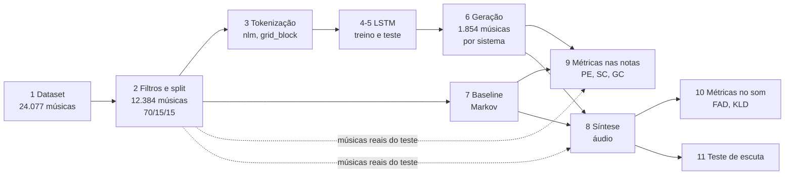
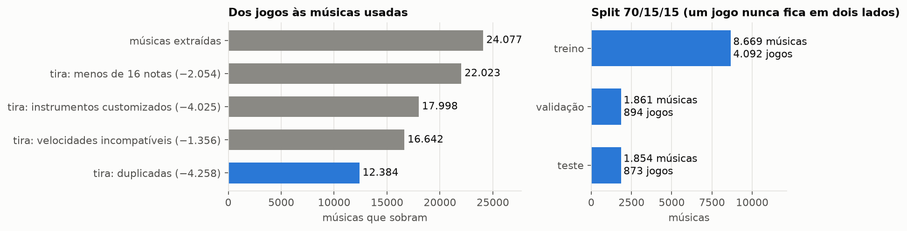
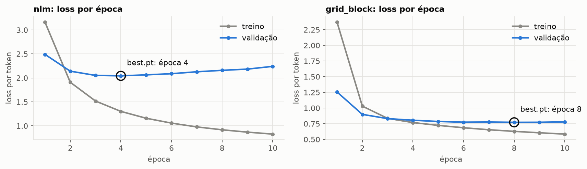
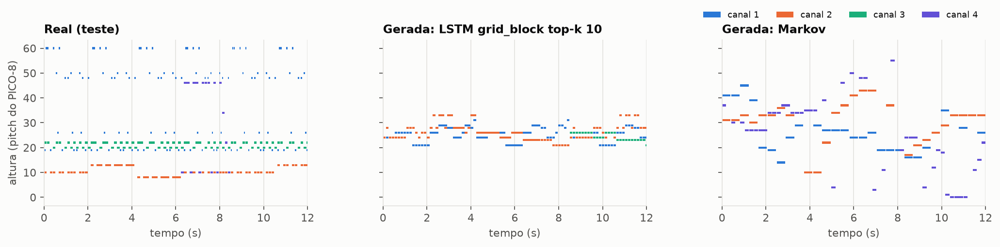
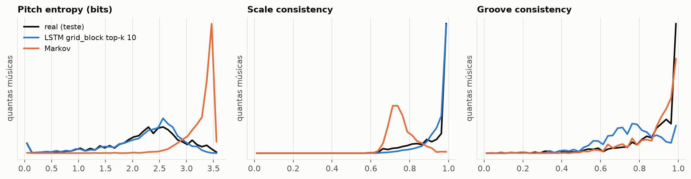
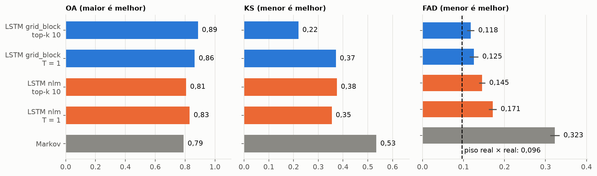
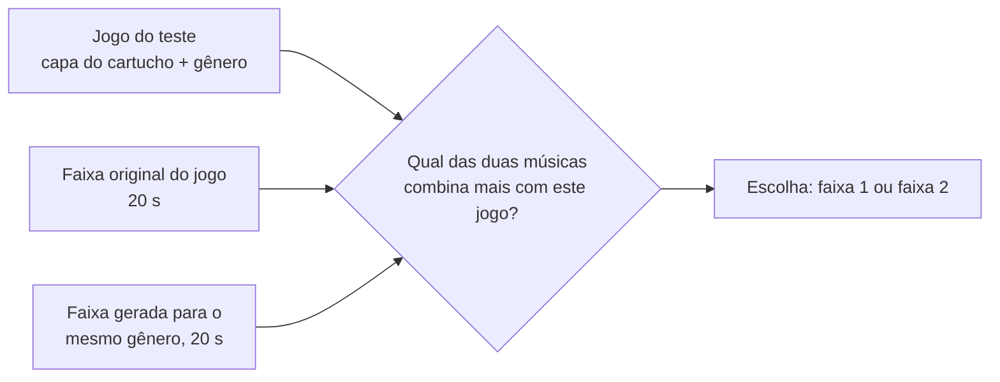

# Mapa do projeto: etapas, decisões e o que falta

Estado em 25/11/2026. Entrega: 25/11, 23:59. Apresentação: 26/11.

**A tarefa.** Ensinar uma rede neural a compor música de PICO-8 (chiptune de 4 canais) nota por
nota, e mostrar que ela faz isso melhor que um baseline simples (cadeia de Markov), comparando
as músicas geradas com músicas reais.

**Onde estão as coisas.**
- Código: este repositório.
- Checkpoints, músicas geradas e tabelas: [Drive](https://drive.google.com/drive/folders/1wirkz0ZRidwRh7db2YXRPaPeTJ1zr4cO) (o `README.md` de lá mapeia cada arquivo).
- Significado de cada métrica, tabelas completas e comandos: [RESULTADOS.md](RESULTADOS.md).
- Cada etapa explicada com os dados reais, figuras e áudio: [notebooks](../notebooks/README.md).

## O caminho, de ponta a ponta



| # | Etapa | Código | Estado |
|---|---|---|---|
| 1 | Dataset | Drive do João | ✅ feito |
| 2 | Filtros e split | `preprocessing/` | ✅ feito, congelado |
| 3 | Tokenização | `src/tokenizer.py`, `src/data.py` | ✅ feito |
| 4 | Modelo | `src/model.py` | ✅ feito |
| 5 | Treino e teste | `src/train.py`, `src/test_perplexity.py`, `src/plot_history.py` | ✅ feito (`nlm`, `grid_block`) |
| 6 | Geração | `src/sample.py` | ✅ feito (4 conjuntos) |
| 7 | Baseline de Markov | `evaluation/markov_baseline.py` | ✅ feito |
| 8 | Síntese | `src/synth.py`, `evaluation/synthesize_jsonl.py` | ✅ feito, fechado |
| 9 | Avaliação simbólica | `evaluation/evaluate_split.py`, `evaluation/distribution_compare.py` | ✅ feito |
| 10 | Avaliação de áudio | `evaluation/audio_metrics.py` | ✅ feito |
| 11 | Teste de escuta | [GiowGiow/pico8-listening-test](https://github.com/GiowGiow/pico8-listening-test) | 🟡 no ar, coletando respostas |
| 12 | Artigo e slides | latex.dcc.ufmg.br | ⏳ confirmar com o grupo |

## Etapa por etapa

### 1 e 2. Dataset, filtros e split

**O que é.** O ponto de partida são 24.077 músicas extraídas de 8.367 jogos de PICO-8. Nem todas
servem, e as que servem precisam ser separadas em treino, validação e teste.



**Decisões e porquês.**

| Decisão | Por quê |
|---|---|
| Tirar músicas com menos de 16 notas | São curtas demais ou silenciosas. |
| Tirar músicas com instrumentos customizados | O sintetizador e o vocabulário só cobrem os 8 instrumentos padrão. |
| Tirar músicas com velocidades incompatíveis entre canais | Não cabem numa grade comum de tempo. |
| Tirar duplicadas | A mesma música aparece copiada em vários jogos; sem isso o modelo veria o teste no treino. |
| Dividir por grupos de jogos, não por música | Jogos que compartilham trechos vão juntos para o mesmo lado. Na divisão antiga, só por jogo, 34,6% das músicas de teste eram idênticas a músicas de treino. |
| Split 70/15/15, congelado | Validação e teste com cerca de 1.850 músicas cada; a lista exata está em `data/splits/split_manifest.csv` e ninguém gera outro split. |

### 3. Tokenização

**O que é.** A rede só entende sequências de símbolos (tokens). Tokenizar é escolher como
escrever uma música como sequência.

**Opções.** O começo da mesma música, nos dois formatos que treinamos:

```
nlm         BOS LOOP_START PATTERN_START REF_SPEED_16 CH1_INST_7 CH1_VOL_7 CH1_NOTEON_21 WT_16 CH1_NOTEOFF ...
grid_block  BOS LOOP_START PATTERN_START REF_SPEED_16 CH1_DEF_BLOCK_0 SPEED_16 STEP_0 PITCH_21 INST_7 VOL_7 STEP_3 PITCH_26 ...
```

| Tokenizador | Ideia | Tokens por música (média) |
|---|---|---|
| `nlm` | Lista de eventos: "canal 1 ligou a nota 21", "espere 16 ticks". | 711 |
| `grid_unrolled` | A grade do tracker, passo a passo, repetindo tudo. | 1.529 |
| `grid_block` | A mesma grade, mas cada bloco repetido é escrito uma vez e depois só referenciado. | 615 |

**Decisão.** Treinar `nlm` e `grid_block` e comparar. O `nlm` é o formato já usado na literatura
(LakhNES); o `grid_block` aproveita que música de tracker repete muitos blocos. O
`grid_unrolled` ficou de fora do treino final: é o `grid_block` sem o reaproveitamento, com
sequências 2,5 vezes mais longas.

### 4 e 5. Modelo, treino e teste

**O que é.** Uma LSTM de 2 camadas que lê os tokens até aqui e dá a probabilidade de cada
próximo token. Treinar é ajustar a rede para acertar o próximo token das músicas de treino.



**Decisões e porquês.**

| Decisão | Por quê |
|---|---|
| Guardar a época com menor loss de validação (`best.pt`) | Depois desse ponto a rede começa a decorar o treino: no `nlm`, a validação piora a partir da época 4. |
| Medir no teste só no fim | O teste não participa de nenhuma escolha; escolhas usam a validação. |
| Comparar tokenizadores por bits por segundo | Loss e perplexidade são por token, e cada tokenizador tem tokens diferentes. Bits/s mede o custo por segundo de música. |

**Resultado.**

| Tokenizador | Melhor época | Val bits/s (menor é melhor) | Perplexidade no teste |
|---|---|---|---|
| `nlm` | 4 de 10 | 85,6 | 7,85 |
| `grid_block` | 8 de 10 | 27,9 | 2,15 |

### 6. Geração

**O que é.** Usar a rede para compor: sorteia um token, coloca na sequência, pergunta de novo,
até a rede emitir o token de fim. Geramos 1.854 músicas por sistema, o tamanho do teste.

**Opções de sorteio.**

| Sufixo | Como sorteia | Efeito |
|---|---|---|
| `t1` | Direto das probabilidades da rede (temperatura 1). | Mais variado, às vezes escolhe tokens improváveis. |
| `k10` | Só entre os 10 tokens mais prováveis (top-k 10). | Mais seguro; corta escolhas estranhas. |

**Decisão.** Gerar os dois para cada modelo (4 conjuntos). O valor 10 não foi ajustado na
validação.

### 7. Baseline de Markov

**O que é.** Um gerador simples para servir de régua: cada canal escolhe a próxima nota olhando
só a nota anterior (cadeia de Markov de 1ª ordem), aprendida no treino.

**Decisão.** A temperatura (1,6) foi escolhida na validação, pelo menor KS médio
(`evaluation/markov_selection.md`).

### 8. Síntese

**O que é.** Transformar a música simbólica em áudio, imitando o chip de som do PICO-8.

**Decisões e porquês.**

| Decisão | Por quê |
|---|---|
| Reescrever o sintetizador seguindo o emulador aberto zepto8 | O anterior tocava as notas certas com o timbre errado. Comparado com gravações do PICO-8 real, a distância espectral caiu de 7,1 para 5,7 dB. |
| Filtros de SFX (reverb, dampen etc.) só nas músicas reais | Eles não estão no `songs.json` nem nos tokens, então o modelo não os gera. As reais os recebem de `src/sfx_filters.json`. |

### 9 e 10. Avaliação

**O que é.** Uma música gerada não tem "gabarito". O que se mede é se o conjunto de músicas
geradas se parece com o conjunto de músicas reais.



**Nas notas (simbólica).** Três medidas por música: variedade de notas (pitch entropy), o quanto
as notas cabem numa escala (scale consistency) e o quanto o ritmo se repete (groove
consistency). Depois compara-se a distribuição de cada sistema com a do teste real:



A LSTM acompanha o real em variedade de notas e em escala; o Markov espalha as notas demais.
No ritmo, a LSTM repete menos que as músicas reais.

**No som (áudio).** As músicas são sintetizadas e um modelo de áudio pré-treinado (CLAP) mede a
distância entre o conjunto gerado e o real (FAD).

**Decisões e porquês.**

| Decisão | Por quê |
|---|---|
| PE, SC e GC como métricas principais | São as métricas do curso. |
| Resumir com OA e KS | Dizem, num número, o quanto duas distribuições coincidem. |
| Medir também real contra real (piso do FAD) | Duas amostras de música real já diferem um pouco; o piso mostra quanto. |

**Resultado.**



- A LSTM com `grid_block` é o melhor sistema nas três medidas.
- Todas as LSTMs ficam à frente do Markov.
- O ponto fraco das LSTMs é o ritmo (groove consistency).

### 11. Teste de escuta

**O que é.** As métricas dizem se as músicas geradas se parecem com as reais nos números. O
teste de escuta pergunta a pessoas se elas servem para um jogo.

- Teste: <https://pico8-bh.giow.dev>
- Código do site e do servidor: <https://github.com/GiowGiow/pico8-listening-test> (o README de
  lá descreve o protocolo completo).

**Como funciona um par.**



- A pessoa não sabe qual faixa é a original: os lados e a ordem são sorteados.
- Cada pessoa avalia 9 pares: 2 de cada gênero (platformer, puzzle, arcade, shmup) e 1 par de
  controle, em que a original enfrenta o Markov.
- O catálogo tem 33 pares: 8 jogos por gênero mais o controle. O servidor entrega primeiro os
  pares menos avaliados.
- No fim há um questionário curto de perfil (idade, experiência musical, familiaridade com
  chiptune).

**Decisões e porquê.**

| Decisão | Porquê |
|---|---|
| Perguntar "qual combina mais com o jogo", e não "qual é a real". | Mede se a música serve ao jogo, que é o uso dela. Adivinhar a origem mede só se há defeitos audíveis. |
| Escolha forçada entre duas faixas. | É mais fácil e mais consistente do que dar notas. Se as geradas forem tão adequadas quanto as originais, a original vence em cerca de 50% das vezes. |
| Gerar a música para o gênero do jogo. | Sem isso, a faixa gerada seria uma música qualquer, e a original venceria só por ser do gênero certo. |
| As duas faixas sem filtros de SFX, com 20 s e o mesmo volume (-16 LUFS). | O modelo não gera filtros de SFX (ver etapa 8). Assim ninguém reconhece a original pelo timbre ou pelo volume. |
| A faixa gerada é sorteada entre as do mesmo gênero. | Escolher a mais parecida com a original favoreceria o modelo. |
| Um par de controle contra o Markov. | Se as pessoas não preferirem a original nem contra o Markov, o teste não está medindo nada. |

**O modelo das faixas geradas é outro.** Os checkpoints das etapas 5 e 6 não recebem nenhuma
informação sobre o jogo. Para o teste treinamos uma LSTM `grid_block` com um token de gênero
no início de cada janela (`<TAG_platformer>`, `<TAG_puzzle>`, ...):

| | Modelo das etapas 5 e 6 | Modelo do teste de escuta |
|---|---|---|
| Tokenizador | `grid_block` | `grid_block` + token de gênero |
| Loss de validação | 0,7723 | 0,7901 (melhor época: 12 de 16; outro código de treino, não comparar direto) |
| Sorteio | temperatura 1 e top-k 10 | top-p 0,95 |
| Músicas geradas | 1.854 por sistema | 100 por gênero |
| Código | `src/train.py`, `src/sample.py` | treino e geração condicionados, fora da `main` (job 23775) |

O gênero de um jogo é a primeira tag dele no BBS da Lexaloffle entre as 8 mais comuns do treino.

**Como os pares foram escolhidos.** Músicas do conjunto de teste com pelo menos 20 s, uma por
cartucho, em ordem sorteada (semente 831), com capa disponível e clipe audível.

**Análise prevista.** Fração das respostas que escolheu a original (geral, por gênero e por
par), com intervalo de confiança, comparada a 50%.

**Limitações.**

- O modelo conhece só o gênero, não o jogo.
- Não há medida automática de que a música gerada segue o gênero pedido; o teste é a medida.
- A coleta começou em 25/11, o dia da entrega, então o número de respostas será pequeno.
- Os resultados das etapas 9 e 10 são dos modelos sem condicionamento, não deste.
- A branch `yuri/subjective-evaluation` tem outro desenho (quatro faixas por cenário, nota de
  1 a 5). O que está no ar é o de pares descrito aqui.

## O que falta

Precisa de decisão do grupo:

- [ ] **Escolher o sistema oficial** para o artigo. Sugestão: `lstm-grid_block-k10`.
- [ ] **Teste de escuta:** entra no artigo? Se entrar, o texto precisa dizer que as faixas vêm do
  modelo condicionado por gênero (etapa 11), e não do sistema oficial.

Falta fazer:

- [ ] Teste de escuta: divulgar o link, coletar respostas e fazer a análise.
- [ ] Artigo: escrever resultados e discussão com as tabelas e figuras acima.
- [ ] Slides da apresentação.
- [ ] `requirements.txt` na raiz do repositório.
- [ ] README: instruções de reprodução de ponta a ponta e contribuição de cada integrante.

Opcional, se sobrar tempo (nada disso muda a conclusão):

- [ ] Escolher o top-k pela validação.
- [ ] Treinar o `grid_unrolled` com o `train.py`, para a comparação ter os três tokenizadores.
- [ ] Calcular bits/s no teste (hoje só existe na validação).

## Limitações já conhecidas

- As músicas geradas não têm par no teste: a comparação é sempre entre distribuições.
- As músicas reais são sintetizadas com filtros de SFX e as geradas sem. O efeito no FAD é
  pequeno e não muda a ordem dos sistemas.
- Demais ressalvas: [RESULTADOS.md](RESULTADOS.md), seção 5.

## Como refazer as figuras

```bash
python docs/figuras/gerar_figuras.py --artefatos <pasta do Drive baixada> --splits data/splits
```
